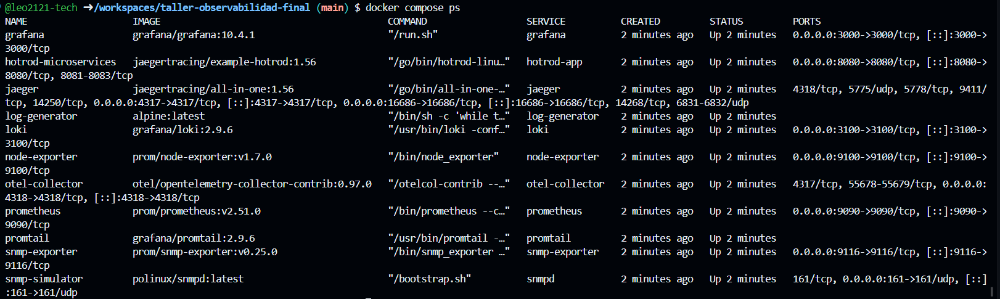
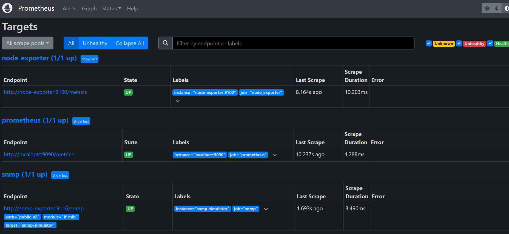
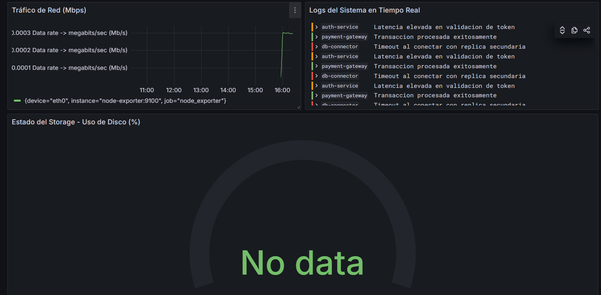
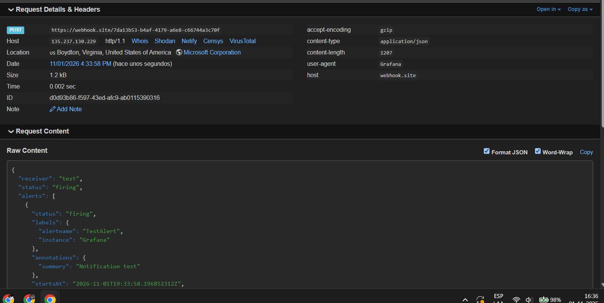
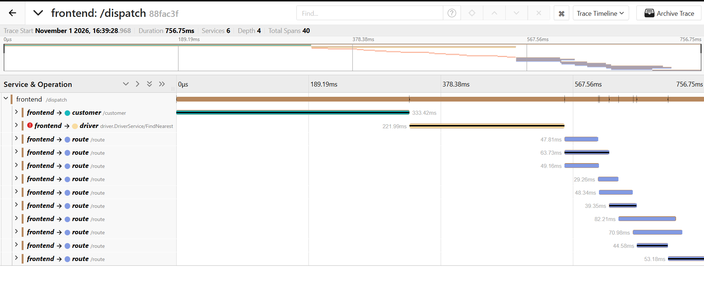

# Evidencias del sistema de observabilidad

## 1. Servicios del stack en ejecución

## 2. Estado de los targets en Prometheus

## 3. Dashboard de observabilidad en Grafana

## 4. Notificación de alerta recibida en Webhook

## 5. Trazas distribuidas en Jaeger

